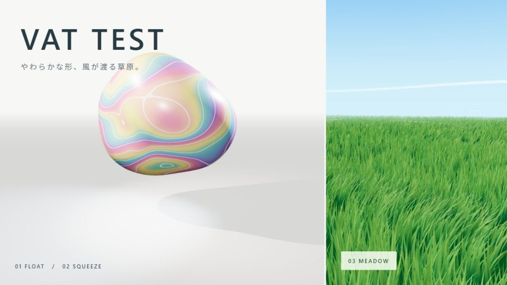

# VAT TEST

Three.js / React Three Fiber / XRiftで動く、VAT（Vertex Animation Texture）の実装サンプルです。頂点の位置・法線をオフラインでテクスチャへ焼き込み、実行時はGPUで再生します。



| モード | 内容 | 技術 |
| --- | --- | --- |
| FLOAT | 直径約5mのマーブル球が変形 | 絶対位置・法線VAT、フレーム補間、PBR材質の拡張 |
| SQUEEZE | 2本の棒に接する部分がへこみ、球が通過 | 接触を模した変形のベイク、影にも同じVATを適用 |
| MEADOW | 風が波として伝わる120m四方の草原 | 差分VAT、GPUインスタンシング、位置ごとの位相差、LOD |

台座のボタンで3モードを切り替えます。XRiftではモードを共有状態、再生位相をサーバー時計から求めます。

## 実行

Node.js 22.12以上の22系、または対応する新しいLTSとnpmを使用します（Vite 7の要件はNode.js 20.19+ / 22.12+）。

```powershell
cd public/VAT_Test
npm ci
npm run dev
```

`http://127.0.0.1:5175/` を開きます。画面のボタンでモードを変更でき、歩行プレビューもあります。`?meadow` を付けると草原から開始します。

生成済みVATを同梱しているため、最初の表示にベイクは不要です。

```powershell
npm run bake            # 球・通過・草のデータを再生成
npm run verify:passage  # 接触の余裕、法線、フレーム間の連続性を検査
npm run typecheck
npm run build           # dist/remoteEntry.jsを生成
```

## ファイル

| 場所 | 役割 |
| --- | --- |
| `src/World.tsx` | 球のVAT再生、マーブル材質、ライト、共有切り替え、床と棒 |
| `src/Meadow.tsx` | 草のVAT、インスタンシング、LOD、風の軌跡、空 |
| `src/dev.tsx` | 開発用Canvas・カメラ・モード切り替え |
| `scripts/bake-vat.mjs` | 球の変形と棒の接触をオフライン生成 |
| `scripts/bake-grass.mjs` | 草のばね運動を計算し、基準姿勢との差分を保存 |
| `scripts/verify-passage.mjs` | 生成済み通過VATの幾何チェック |
| `public/vat-*.bin` / `public/vat-*metadata.json` | 位置・法線・基準メッシュと形式情報 |
| `artifacts/thumbnail/` | 実画面とHTMLによるサムネイルの制作元 |
| [docs/VAT_TECHNICAL_NOTES.md](docs/VAT_TECHNICAL_NOTES.md) | データ形式、数式、描画、配信、検証の知見 |

## XRiftへの配置

```powershell
npx @xrift/cli login
npx @xrift/cli upload world
```

`xrift.json`にワールド名・説明・サムネイル・物理・カメラ設定があります。CLIがビルドと標準セキュリティチェックを実行します。CLIは独立したツールなので、このプロジェクトのnpm lockfileとは別に管理されます。

既存の配信先IDや認証情報は含めていません。各環境で作成される`.xrift/`はGit対象外です。公開範囲と稼働バージョンはアップロード後にXRift側で確認してください。

## 実装の範囲

球の通過はベイク済みの動きであり、棒を実行時に動かしても変形は追従しません。草の風は位置と時刻から再生位相を決めます。白い風の軌跡は手続き的なシェーダー表現です。

ブラウザ描画・型検査・ビルド・XRiftの標準チェックと配信アセットの取得を確認しています。Questのフレームレート、複数人での切り替えと位相の実測、任意の障害物に対するリアルタイム軟体物理は検証・実装範囲に含みません。
